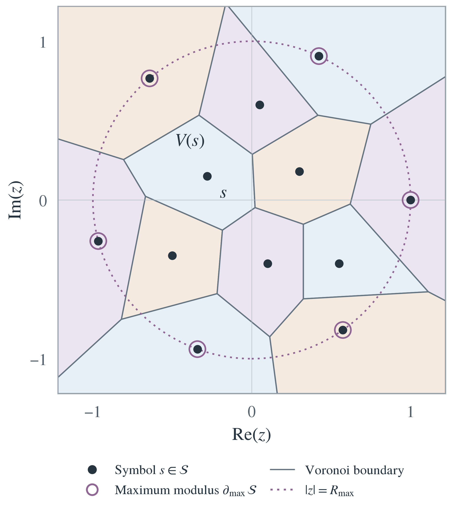
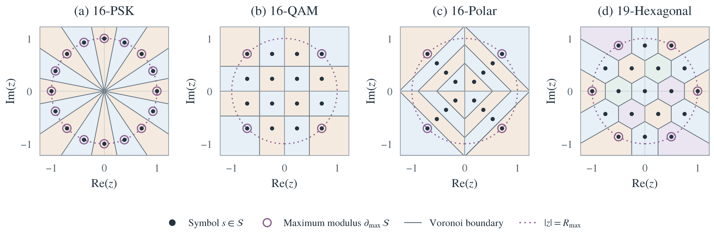
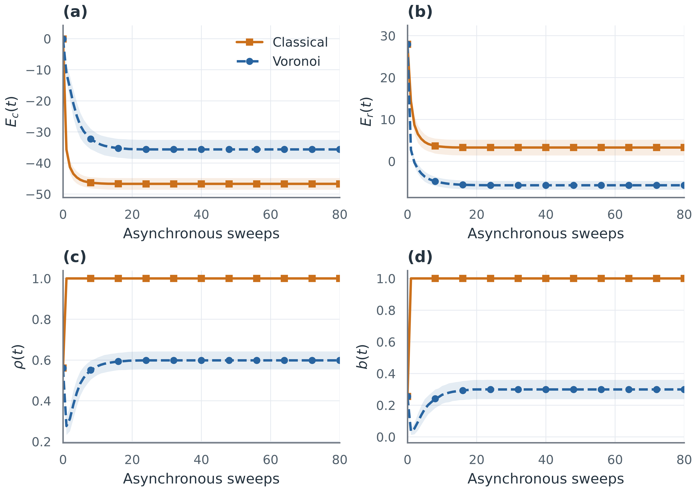
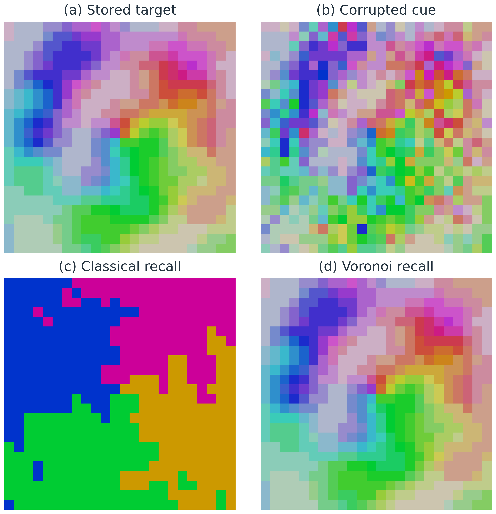
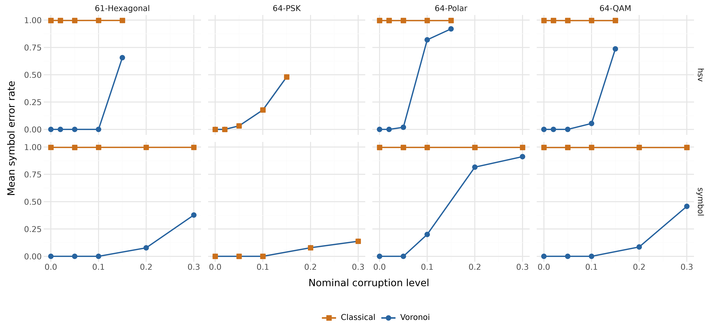
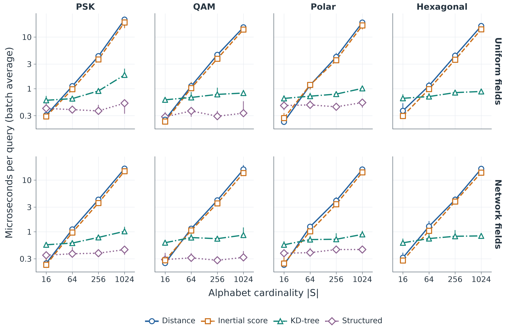

# Figure gallery

## Alphabet geometry

The illustrative alphabet has 12 deliberately spaced symbols. Each diagram
identifies the finite alphabet, exact cell boundaries, and maximum-modulus symbols. Pastel fills distinguish adjacent cells. A dotted
circle shows the maximum radius; it is not a Voronoi boundary. The four experimental
alphabets retain exactly the coordinates used in the simulations and appear in
one row. Solid and dotted lines and hollow rings remain distinct in grayscale.

[PDF](../figures/generic_voronoi.pdf) · [SVG](../figures/generic_voronoi.svg) · [Symbol coordinates](../figures/source_data/irregular_symbols.csv)

[PDF](../figures/constellations.pdf) · [SVG](../figures/constellations.svg)

[Experimental alphabet coordinates](../figures/source_data/geometry_alphabets.csv) ·
[Geometric verification](../validation/geometry_check.json).
Regenerate only these diagrams with `python scripts/render_geometry.py`.

## Energy and radial behavior

Means and one-standard-deviation bands over 100 runs. Square/solid: classical. Circle/dashed: Voronoi. [PDF](../figures/saturation_diagnostics.pdf) · [Plotting data](../figures/source_data/saturation_plot.csv)

## Recall

The selected successful trial, seed 120044901, is illustrative. The colors encode hue and saturation and must not be replaced by the chart palette. [PDF](../figures/hsv_recall.pdf) · [Recomputed metrics](../figures/source_data/paper_visual_metrics.csv)

[PDF](../figures/recall_summary.pdf) · [Plotting data](../figures/source_data/recall_plot.csv)

All figures use Seaborn/Matplotlib or Plotnine, a shared palette, vector PDF/SVG, and 600 dpi PNG. Curve markers distinguish rules in grayscale. Geometry is computed as clipped Voronoi half-plane intersections, not reconstructed from screenshots.

## Cardinality scaling

[PDF](../figures/activation_scaling.pdf) · [SVG](../figures/activation_scaling.svg) ·
[Plot data](../figures/source_data/activation_scaling.csv). Medians and full ranges
of five batch timings; methods have distinct colors, markers, and line patterns.
